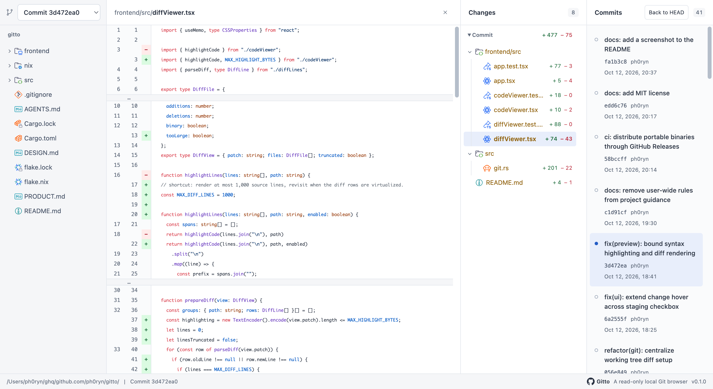

# gitto

<p align="center">
  
</p>

ローカルのGitリポジトリをブラウザーで閲覧する、読み取り専用のCLIです。  
コミット履歴、ブランチ・タグ、ファイル、staged／unstaged／untrackedの差分を表示します。

## Demo

[Interactive preview](https://ph0ryn.github.io/gitto/)で、インストールせずにgittoのUIを試せます。
架空のリポジトリを使い、ファイル閲覧・差分・コミット履歴・ブランチ切り替え・全文検索を操作できます。

## Usage

```sh
nix run github:ph0ryn/gitto#gitto -- .
```

1リポジトリにつき1プロセスで、`127.0.0.1`の空きポートを使います。

インストール後は、`gitto .`で起動できます。

```sh
gitto /path/to/repository
gitto . --no-open
gitto . --port 3000
gitto --licenses
gitto --help
```

## Installation

### Prebuilt binary

Nixなしで利用する場合は、[GitHub Releases](https://github.com/ph0ryn/gitto/releases)から環境に合う`gitto-<version>-<target>.tar.gz`をダウンロードします。

| OS / CPU | target |
| --- | --- |
| macOS / Apple Silicon | `aarch64-apple-darwin` |
| Linux / x86_64 | `x86_64-unknown-linux-musl` |
| Linux / ARM64 | `aarch64-unknown-linux-musl` |

ダウンロードしたファイルを展開し、`gitto`を任意の場所に配置します。

```sh
tar -xzf 'gitto-<version>-<target>.tar.gz'
```

### Nix

利用する`flake.nix`にgittoのinputを追加します。

```nix
inputs.gitto = {
  url = "github:ph0ryn/gitto";
  inputs.nixpkgs.follows = "nixpkgs";
};
```

NixOS・nix-darwinの設定モジュールに、overlayとパッケージを追加します。

```nix
{ inputs, pkgs, ... }:
{
  nixpkgs.overlays = [ inputs.gitto.overlays.default ];
  environment.systemPackages = [ pkgs.gitto ];
}
```

対応するsystemは`x86_64-linux`・`aarch64-linux`・`aarch64-darwin`です。

## Features

- ブランチ・タグを選んで、コミット履歴やファイルを閲覧できます。
- コミットを選んで、過去のファイルやそのコミットの変更内容を確認できます。
- 作業中の変更を、Staged・Unstaged・Untrackedに分けて確認できます。
- ファイルと差分を、構文ハイライトと行番号付きで閲覧できます。通常のファイル表示でも変更箇所を確認できます。
- 作業ツリーまたは閲覧中のブランチ・コミットを全文検索できます。ファイルごとに一致箇所の前後を表示し、該当行を開けます。
- リポジトリの変更を約2秒ごとに自動で反映します。選択中のコミットやフォルダーの展開は維持されます。
- 最初のコミットを作る前でも、作業中の変更を確認できます。

## Limitations

- 閲覧専用です。ファイルの編集やcommit・stage・checkout・fetchはできません。
- 起動したマシン上のブラウザーで利用します。他のマシンからのアクセスには対応していません。
- ファイルの内容はUTF-8のテキストのみ表示します。バイナリ、2 MiBを超えるファイル、サブモジュールの内容はプレビューできません。2 MiBを超えるファイルの差分も本文を省略しますが、追加・削除行数は表示します。
- 構文ハイライトは16 KiBまでです。それを超える本文や差分は、ハイライトなしのテキストとして表示します。
- 全文検索は大文字・小文字を区別する文字列検索です。作業ツリーでは未追跡ファイルも含め、ignoredファイルは除外します。バイナリ、非UTF-8、2 MiB超、サブモジュールは検索対象外です。結果は最大200一致行・本文合計2 MiBで、省略を画面に表示します。検索語の強調は各抜粋16 KiB・1,000箇所までです。検索結果の更新は検索を再実行してください。
- 差分の本文は2 MiBまで取得し、表示は最大1,000行です。省略がある場合は画面に表示します。
- 差分の追加・削除行数はファイル全体から計算します。表示上限を超えるファイルも計算対象です。
- GitのパスやメタデータがUTF-8でない場合は、エラーを表示します。
- MarkdownやHTMLはテキストとして表示します。MarkdownのプレビューやHTMLの実行はできません。
- マージコミットの差分は、最初の親コミットと比較します。
- 競合中のUnstaged差分は、自分側の内容と現在の作業ファイルを比較します。共通の祖先・自分側・相手側を並べる表示はありません。
- bareリポジトリでは、履歴とコミット済みファイルのみ閲覧できます。
- シンボリックリンクはリンク先の文字列のみ表示します。作業ツリーの`.git`やリポジトリ外のファイルは閲覧できません。

## Development

RustのCLIとHTTPサーバーをルートに、Vite+・React・TypeScriptを`frontend/`に置きます。
frontendはpnpmで依存を固定し、`vp`で開発・ビルド・テスト・lint・formatを実行します。
Gitへのアクセスにはgit2-rsと同梱したlibgit2を使います。
frontendの生成物はrust-embedで実行ファイルへ埋め込みます。

以下のコマンドは、gittoをcloneしたディレクトリで実行します。

### Development

```sh
nix develop
(cd frontend && pnpm install --frozen-lockfile && pnpm exec vp build)
cargo build
```

HMRを使う場合は、別々のターミナルで起動します。

```sh
cargo run -- . --port 3000 --no-open
```

```sh
cd frontend
pnpm exec vp dev
```

`http://127.0.0.1:5173`を開きます。Viteが`/api`をRustへプロキシします。

### Build and checks

```sh
nix flake check
nix build
```
